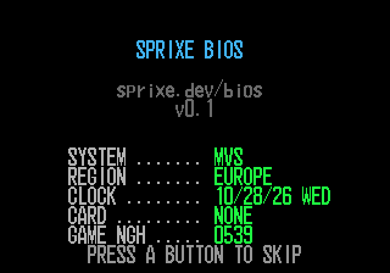
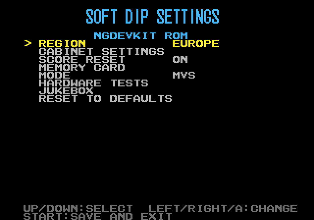
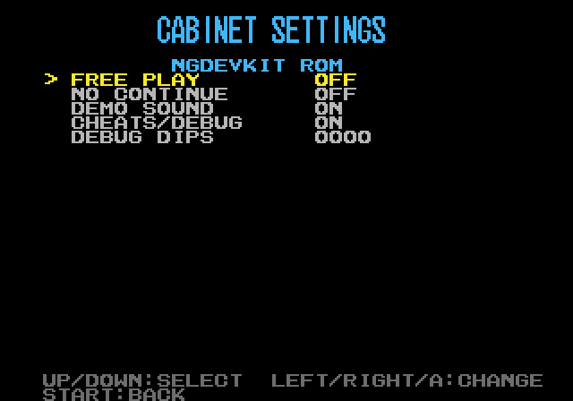
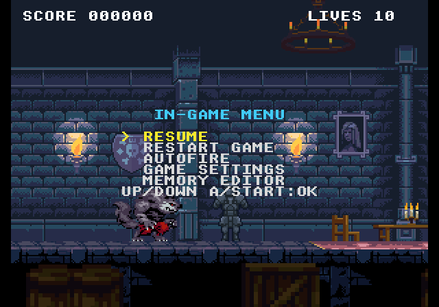
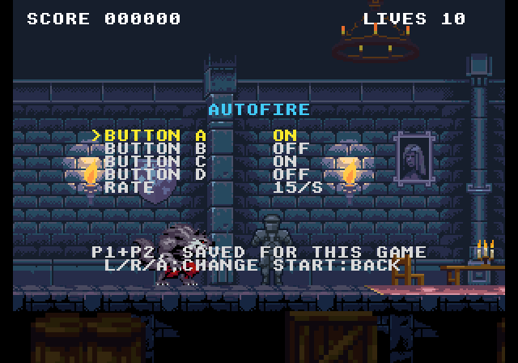
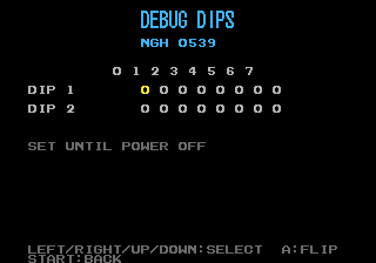
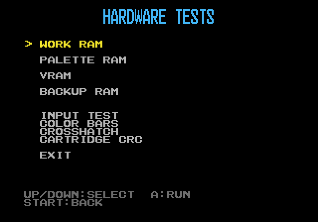
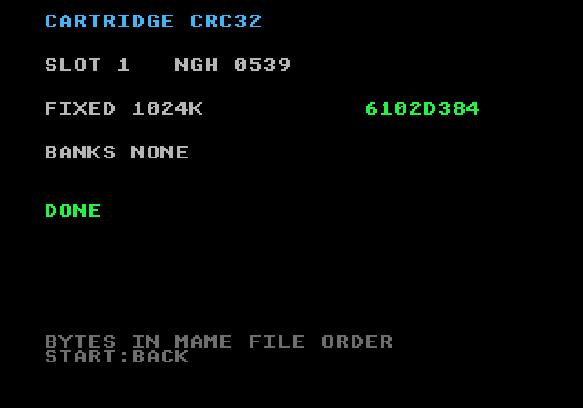
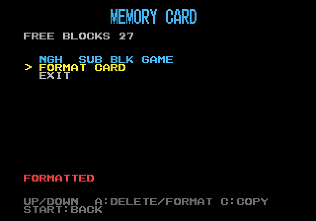
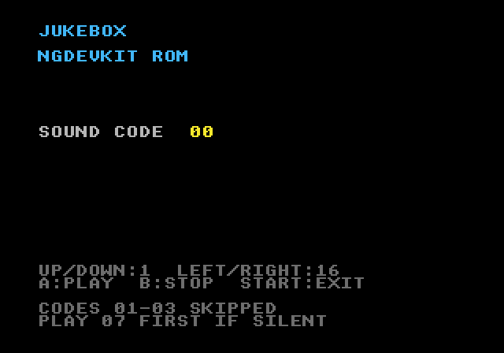

# Sprixe BIOS

The test scene, mutation and catalogue figures are measured locally under MAME, with our own ROM
sets ([`docs/BENCH.md`](docs/BENCH.md), [`measured/HISTORIQUE.md`](measured/HISTORIQUE.md)). The CI
builds the image, checks its SHA-256 and runs the generators' tests; it does not run MAME.

Sprixe BIOS is a free, open-source replacement BIOS for the Neo Geo MVS arcade board, written from
scratch in 68000 assembly and tested game by game. It plays the role players know from UniBIOS: hold
START + SELECT during a game and a menu opens with the game's settings, cheats, a memory editor and
autofire remembered for each game. Operators get free play, no continue and a silent demo for every
game, and one switch that turns cheats and debug off for the whole board. None of its code comes
from SNK or from any game. It is licensed under the GPL-3.0-or-later.

Website: https://bios.sprixe.dev/ (sources in [`site/`](site/), see [`docs/SITE.md`](docs/SITE.md)).

Status: in testing.

Sprixe BIOS was developed under the working name ReBIOS; that name still appears in dated notes and
in the backup RAM signature.

## Screenshots

Taken under MAME 0.286 from the image this repository builds (SHA-256 `18da0b0a…`; the boot screen
from `8d9a7611…`), with Magic Castle, a homebrew game made with the Sprixe studio, as the
cartridge. The in-game menu and autofire screens are over Metal Slug (© SNK).

| | | |
|---|---|---|
|  Boot screen |  Test menu (soft-DIP settings) |  Cabinet settings |
|  In-game menu |  Autofire, per game |  Debug dips |
|  Hardware tests |  Cartridge CRC32 |  Memory card manager |
|  Jukebox | | |

## Features

**Playing**
- Per-game autofire: buttons A to D set one by one, at 10, 15 or 30 shots per second, remembered
  for each game. It only reaches games that read the controls through the BIOS
  (see [Compatibility](#compatibility)).
- Cheats for 81 games (117 cheats), found by observing the games under MAME.
- Soft-DIPs during a game (GAME SETTINGS in the in-game menu), and the soft-DIP editor at boot.
- Soft-DIPs of a game never launched: the editor shows the cartridge defaults and saves a clean
  entry. A garbled entry left by another BIOS is checked value by value before the game sees it.

**Saving**
- High scores kept in backup RAM in MVS and AES modes, with SCORE RESET to stop the periodic wipe.
  Not saved on the memory card.
- Memory card manager, in the test screen: list, free blocks, delete, format, and copy one save to
  another card. No COPY ALL.

**Operators and repair**
- Cabinet settings: FREE PLAY, NO CONTINUE, DEMO SOUND, and CHEATS/DEBUG OFF, which removes the
  cheats, the memory editor and the debug dips. Board switch 7 also gives free play.
- Boards without a TEST button: switch 1, or START + SELECT held at power-on, opens the test screen.
- Cartridge CRC32 of the fixed P-ROM and of each bank, as the 68000 reads them. SMA and PVC
  protected cartridges are not recognised yet.
- RAM editor with value freezing, and debug dips. No VRAM viewer.
- Input test for both joysticks and the mahjong panel. No 4-player page.
- Hardware tests: work RAM, palette, VRAM and backup RAM checks, colour bars, crosshatch.

**Boot and multi-slot**
- The boot screen uses only the BIOS font, nothing from the cartridge's graphics.
- Multi-slot boards: SELECT changes game; tested on a six-slot MV-6F under MAME and on a real
  two-slot MV-2F.
- AES mode on an MVS board: set MODE to AES and games show their home version.

**Extras**
- Jukebox, with a screen saver: black screen after about two minutes, music keeps playing.

Not included: menu colours, US-style credit display, Arcade VS, PC-2-NEO, PICKnMIX. There is no image
for the AES console itself.

The menus, and the keys and board switches that lead to them, are mapped in
[`docs/MENUS.md`](docs/MENUS.md).

## Installation

Build the image first ([`docs/BUILD.md`](docs/BUILD.md)). The build produces a 128 KiB file in MAME
byte order, the same as `sp-s2.sp1` in `neogeo.zip`.

### On an MVS board

1. Burn the image on a 27C1024 EPROM. Most programmers take the MAME byte order as is; if the board
   shows nothing, try the image with its bytes swapped in pairs.
2. Keep the original BIOS chip. Swap it out, mind the notch. On some boards the BIOS chip is
   soldered and needs a socket first.
3. Power on: the Sprixe BIOS screen shows for a moment, then the game starts.

### In MAME

1. Work on copies of your sets.
2. Replace `sp-s2.sp1` with the Sprixe BIOS file in `neogeo.zip`, **and also in the game's zip if
   your set is non-merged**: each of those zips carries its own copy of the BIOS, and MAME reads it
   first. Replacing it in `neogeo.zip` alone then changes nothing.
3. Run the game with `-bios euro`.
4. MAME warns `WRONG CHECKSUMS` for `sp-s2.sp1`. That warning means Sprixe BIOS is the BIOS in use;
   without it, MAME found the original BIOS somewhere else.

No ROM of any kind is provided by this repository.

## Compatibility

Measured under MAME 0.286, on the 164 games of our MAME catalogue, each run under Sprixe BIOS, the
SNK BIOS and UniBIOS 4.0 (`bench/matrice.sh`, `measured/HISTORIQUE.md`):

- 161 of 164 games play under Sprixe BIOS, 162 under the SNK BIOS and under UniBIOS 4.0.
- `mvstemp` and `vliner` freeze under all three BIOSes.
- `irrmaze` cannot be judged: the harness fails to substitute the BIOS for that set.

Autofire, measured on player 1's A button: 89 games see it fully, 25 partly, 35 never (they read the
joystick themselves), 15 were not measured ([`docs/AUTOFIRE.md`](docs/AUTOFIRE.md)).

On real hardware, Sprixe BIOS has run on one board so far, an MV-2F. Issues found there and fixed:
the cartridge header was read at the wrong moment (the board rebooted in a loop), a board without a
TEST button could not reach the settings, and a BlueRetro wireless adapter holding every button at
wake-up opened the test screen. Other MVS boards and AES consoles are untested.
See [`docs/ESSAI-MATERIEL.md`](docs/ESSAI-MATERIEL.md).

## Method

No code from SNK, UniBIOS or any game was copied or disassembled. The original BIOS was observed
while it ran — under MAME, and early on through bus traces in a co-simulation — and contracts were
drawn from those observations; agents that had only those contracts and public documentation wrote
the code. Every function the player sees has a test scene under MAME, and every scene is checked by
deliberately breaking the BIOS. The full account, including one incident, is in
[`docs/METHOD.md`](docs/METHOD.md).

## Building and testing

- Build: [`docs/BUILD.md`](docs/BUILD.md) (Docker only).
- Test bench, regression suite and scenes: [`docs/BENCH.md`](docs/BENCH.md) (needs MAME and your
  own ROM sets).

## Contributing

See [`CONTRIBUTING.md`](CONTRIBUTING.md). Questions go to
[Discussions](https://github.com/lid-labs/sprixe-bios/discussions).

## Thanks

Sebastian Klötzer, for testing every image on a real MV-2F board and reporting what MAME could
not show.

## License

GPL-3.0-or-later. See [`LICENSE`](LICENSE).

Neo Geo, MVS and AES are trademarks of SNK Corporation. Sprixe BIOS is not affiliated with SNK or
with the author of UniBIOS.
